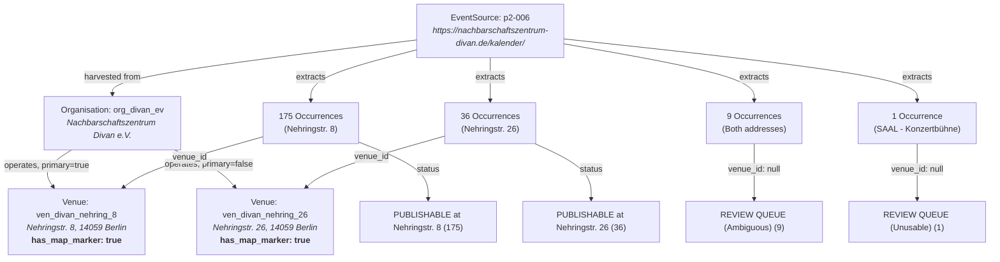

# Architectural Decisions, Divan Benchmark & Edge Cases

**Status: Proposed Specification**  
**Document:** `ARCHITECTURE_DECISIONS.md`  
**Part of:** Architecture Design for Berlin Kiez Events Atlas

---

## 1. Architectural Decision Records (ADRs)

### ADR-001: Entity Separation of Organisation, Venue, and Relationship
- **Status:** Proposed
- **Context:** The inherited data model used a single flat `PLACES` array representing both the cultural entity and physical coordinates. Phase 2 proved that organisations operate multiple buildings, share buildings, and host off-site events.
- **Decision:** Separate `Organisation` (legal/community actor), `Venue` (physical building/coordinates), and `OrganisationVenueRole` (relational link).
- **Alternatives Considered:**
  1. *Add `secondary_address` to Venue:* Rejected. Still conflates organisation with place and fails when three organisations share one building.
  2. *Add `operating_organisation_id` foreign key directly to Venue:* Rejected. Fails for co-located multi-tenant venues and prevents recording temporal lease changes.
- **Trade-offs:** Introduces relational joins during compilation; drastically improves attribution correctness and eliminates sibling misattribution.

---

### ADR-002: Separation of EventSeries and EventOccurrence
- **Status:** Proposed
- **Context:** Divan revealed 221 records representing only 58 distinct titles, with 220 recurring instances. Publishing flat records causes map clutter, renders 85 expired events, and prevents single-session cancellations.
- **Decision:** Split into `EventSeries` (canonical programme concept and recurrence template) and `EventOccurrence` (concrete dated instance).
- **Alternatives Considered:**
  1. *Flat events with a boolean `is_recurring`:* Rejected. Fails to group sessions or model title overrides.
  2. *Publish only series templates without concrete dates:* Rejected. Users cannot tell if a session is running this Tuesday or if it is cancelled.
- **Trade-offs:** Requires an occurrence expansion engine in the ingestion pipeline; provides clean calendar UI rendering and robust cancellation handling.

---

### ADR-003: Deterministic Semantic Identifiers vs Random UUIDs
- **Status:** Proposed
- **Context:** Web scrapers frequently re-crawl listings where HTML element order, database internal IDs, and page pagination change. Random UUIDs cause churn on every fetch.
- **Decision:** Use deterministic, human-readable slug prefixes combined with semantic hashing:
  - `org_{slug}` (e.g. `org_divan_ev`)
  - `ven_{name_slug}_{street}_{nr}` (e.g. `ven_divan_nehring_8`)
  - `srs_{org_short}_{title_slug}` (e.g. `srs_divan_yoga_stuhl`)
  - `occ_{srs_slug}_{YYYYMMDD_HHMM}` (e.g. `occ_divan_yoga_stuhl_20261117_1000`)
- **Alternatives Considered:**
  1. *Opaque UUIDv4:* Rejected. Non-deterministic; impossible to inspect or trace during debugging without a lookup table.
  2. *Array index or auto-incrementing integer:* Rejected. Incompatible with decentralized git workflows and incremental ingestion.
- **Trade-offs:** Requires explicit slugification and collision-detection logic in the compiler; provides deterministic reproducibility across machines.

---

### ADR-004: Decoupling Event Sources from Physical Venues
- **Status:** Proposed
- **Context:** In `PHASE2_SOURCE_REGISTRY.json`, sources were tied to `venue_id`. For Divan (`p2-006`), the calendar feed is published by the organisation and includes events at multiple buildings.
- **Decision:** Event sources can attach to either an `Organisation` (e.g. an organisation-wide calendar) or a `Venue` (e.g. a room booking calendar). Extracted occurrences undergo per-event physical attribution.
- **Alternatives Considered:**
  1. *Duplicate the source registry entry per building:* Rejected. Would cause double-fetching of the same calendar and double-counting.
- **Trade-offs:** Scraper pipelines cannot blindly assign the source's venue to all records; attribution must run per occurrence.

---

### ADR-005: Strict Two-Factor Publication Gate
- **Status:** Proposed (Already validated in `pipelines/src/kiez_atlas/attribution.py`)
- **Context:** Sibling-building events are genuinely `hosted` by the organisation. A classification-only check publishes sibling events at the primary marker.
- **Decision:** An occurrence is published at a venue marker **if and only if**:
  $$\text{classification} == \text{"hosted"} \quad \land \quad \text{site} == \text{"mapped_venue"}$$
- **Alternatives Considered:**
  1. *Publish all organisation events at the headquarters marker with a disclaimer tag:* Rejected. Misleads users about physical location.
- **Trade-offs:** 36 sibling events remain unpublished until Nehringstr. 26 has its own venue record. This is the correct, honest outcome.

---

### ADR-006: Lightweight File-Based Storage in Python
- **Status:** Proposed
- **Context:** Architectural guidelines prohibit unnecessary infrastructure complexity (Postgres, Redis, message brokers).
- **Decision:** All canonical data will be stored as structured JSON and JSON Lines on disk in `data/internal/`. Python dataclasses and standard library modules (`json`, `pathlib`, `hashlib`) handle loading and indexing.
- **Alternatives Considered:**
  1. *SQLite database file:* Considered. Feasible, but plain JSON git diffs are more human-auditable and integrate directly with GitHub Actions.
  2. *PostgreSQL daemon:* Rejected. Massive operational overhead for <1,000 venues and <10,000 active events.
- **Trade-offs:** Bulk updates write whole JSON files; trivial to maintain, zero deployment cost, 100% git-versionable.

---

### ADR-007: Deterministic Attribution Rules Over Machine Learning / LLMs
- **Status:** Proposed
- **Context:** Using non-deterministic LLM prompts to decide whether an event is at Nehringstr. 8 or 26 introduces flaky tests, hallucinated venue assignments, and costly API calls.
- **Decision:** Venue matching uses deterministic regex address normalisation (`normalise_address`), exact house-number guards, and pre-match ambiguity checks. Uncertain records go to `review_queue.json`.
- **Alternatives Considered:**
  1. *LLM-based entity extraction:* Rejected as a core pipeline dependency. Deterministic rules are reproducible, explainable, and run in milliseconds.
- **Trade-offs:** Cannot automatically resolve complex unstructured colloquial descriptions; requires human review for edge cases.

---

### ADR-008: Projection-Based Backward Compatibility
- **Status:** Proposed
- **Context:** The static frontend (`index.html`) depends on `data/public/venues.json` (v0.3.0) and embedded `PLACES` data.
- **Decision:** Maintain legacy files as compiled projections from canonical internal entities. `index.html` remains byte-identical to committed hash `927d63a91919`.
- **Alternatives Considered:**
  1. *Update `index.html` immediately:* Rejected. Out of scope and breaks frozen baseline.
- **Trade-offs:** Requires running compilation scripts before release; guarantees zero frontend regressions.

---

## 2. Divan Benchmark Test: Concrete Modelling Walkthrough

The proposed model must cleanly represent all findings from `docs/phase2/divan/DIVAN_ATTRIBUTION_AUDIT.md`:
- Total records: 221 (58 distinct titles).
- Nehringstraße 8 (mapped): 175 records.
- Nehringstraße 26 (sibling): 36 records.
- Ambiguous (both addresses): 9 records.
- Unusable location (`SAAL - Konzertbühne`): 1 record.
- Current publishable count at mapped venue: **Exactly 175**.



---

### Concrete JSON Instances for Divan

#### 1. Organisation Record (`data/internal/organisations.json`)
```json
{
  "schema_version": "0.4.0",
  "organisation_id": "org_divan_ev",
  "canonical_name": "Nachbarschaftszentrum Divan e.V.",
  "legal_name": "Interkulturelles Stadtteilzentrum, Nachbarschaftszentrum Divan e.V.",
  "aliases": ["Divan", "Stadtteilzentrum Divan", "NBZ Divan"],
  "organisation_type": "registered_association",
  "description": "Intercultural neighbourhood centre in Charlottenburg offering meetings, exercise, advice, learning and volunteering.",
  "website": {
    "url": "https://www.nachbarschaftszentrum-divan.de",
    "verification_status": "verified_official"
  },
  "verification_status": "verified",
  "source_references": [
    {
      "source_name": "Phase 1 Atlas Inventory",
      "reference_url": "https://stadtteilzentren.de/orte/charlottenburg-wilmersdorf/interkulturelles-stadtteilezentrum-nachbarschaftszentrum-divan-e-v/",
      "observed_at": "2026-11-14"
    }
  ],
  "created_at": "2026-11-14T09:10:57Z",
  "updated_at": "2026-11-27T12:00:00Z"
}
```

#### 2. Physical Venue 1: Mapped Primary Building (`data/internal/venues.json`)
```json
{
  "schema_version": "0.4.0",
  "venue_id": "ven_divan_nehring_8",
  "legacy_atlas_id": "interkulturelles-stadtteilzentrum-divan",
  "canonical_name": "Interkulturelles Stadtteilzentrum Divan (Nehringstr. 8)",
  "aliases": ["Divan Hauptgebäude"],
  "venue_type": "community_centre",
  "access_type": "public_building",
  "address": {
    "street": "Nehringstraße",
    "house_number": "8",
    "building_part": null,
    "postcode": "14059",
    "city": "Berlin",
    "district": "Charlottenburg-Wilmersdorf"
  },
  "coordinates": {
    "latitude": 52.51654,
    "longitude": 13.29375
  },
  "coordinate_precision": "exact_building",
  "lor_id": "043004",
  "lor_name": "Schloss Charlottenburg",
  "lor_plr_id": "04300413",
  "has_map_marker": true,
  "parent_venue_id": null,
  "verification_status": "verified",
  "created_at": "2026-11-14T09:10:57Z",
  "updated_at": "2026-11-27T12:00:00Z"
}
```

#### 3. Physical Venue 2: Sibling Building (`data/internal/venues.json`)
```json
{
  "schema_version": "0.4.0",
  "venue_id": "ven_divan_nehring_26",
  "legacy_atlas_id": null,
  "canonical_name": "Divan Mehrgenerationenhaus (Nehringstr. 26)",
  "aliases": ["Mehrgenerationenhaus Divan", "MGH Nehringstraße"],
  "venue_type": "community_centre",
  "access_type": "public_building",
  "address": {
    "street": "Nehringstraße",
    "house_number": "26",
    "building_part": null,
    "postcode": "14059",
    "city": "Berlin",
    "district": "Charlottenburg-Wilmersdorf"
  },
  "coordinates": {
    "latitude": 52.51821,
    "longitude": 13.29412
  },
  "coordinate_precision": "exact_building",
  "lor_id": "043004",
  "lor_name": "Schloss Charlottenburg",
  "lor_plr_id": "04300413",
  "has_map_marker": true,
  "parent_venue_id": null,
  "verification_status": "verified",
  "created_at": "2026-11-17T17:08:19Z",
  "updated_at": "2026-11-27T12:00:00Z"
}
```

#### 4. Organisation Venue Roles (`data/internal/organisation_venue_roles.json`)
```json
[
  {
    "role_id": "ovr_divan_nehring_8_operates",
    "organisation_id": "org_divan_ev",
    "venue_id": "ven_divan_nehring_8",
    "role_type": "operates",
    "is_primary_headquarters": true,
    "valid_from": "2015-01-01",
    "valid_until": null,
    "verification_status": "verified",
    "evidence_type": "official_directory",
    "evidence_description": "Registered headquarters and primary intercultural centre."
  },
  {
    "role_id": "ovr_divan_nehring_26_operates",
    "organisation_id": "org_divan_ev",
    "venue_id": "ven_divan_nehring_26",
    "role_type": "operates",
    "is_primary_headquarters": false,
    "valid_from": "2018-06-01",
    "valid_until": null,
    "verification_status": "verified",
    "evidence_type": "official_directory",
    "evidence_description": "Second site operating the Mehrgenerationenhaus."
  }
]
```

#### 5. Recurring Event Series Example: Yoga auf dem Stuhl (`data/internal/event_series.json`)
```json
{
  "schema_version": "0.4.0",
  "series_id": "srs_divan_yoga_stuhl",
  "canonical_title": "Yoga auf dem Stuhl",
  "title_variants": ["Yoga auf dem Stuhl II", "Stuhlyoga für Senior*innen"],
  "description_template": "Sanfte Yogaübungen auf und mit dem Stuhl für Beweglichkeit und Wohlbefinden im Alter.",
  "organiser_id": "org_divan_ev",
  "default_venue_id": "ven_divan_nehring_8",
  "series_type": "weekly_group",
  "recurrence_rule": "FREQ=WEEKLY;BYDAY=TU",
  "default_category": "sport_outdoor",
  "status": "active",
  "source_references": [
    {
      "source_id": "p2-006",
      "source_url": "https://nachbarschaftszentrum-divan.de/kalender/",
      "first_seen": "2026-11-16"
    }
  ],
  "created_at": "2026-11-16T00:00:00Z",
  "updated_at": "2026-11-27T12:00:00Z"
}
```

#### 6. Mapped Occurrence Example (1 of the 175 publishable records)
```json
{
  "schema_version": "0.4.0",
  "occurrence_id": "occ_divan_yoga_stuhl_20261117_1000",
  "series_id": "srs_divan_yoga_stuhl",
  "title": "Yoga auf dem Stuhl",
  "description": null,
  "start_datetime": "2026-11-17T10:00:00+01:00",
  "end_datetime": "2026-11-17T11:00:00+01:00",
  "timezone": "Europe/Berlin",
  "venue_id": "ven_divan_nehring_8",
  "room_note": "Bewegungsraum EG",
  "organiser_id": "org_divan_ev",
  "access_mode": "physical_in_person",
  "category": "sport_outdoor",
  "price": {
    "price_status": "free",
    "amount_min": 0,
    "amount_max": 0,
    "currency": "EUR",
    "is_under_20_eur": true,
    "price_note": "Kostenloses Angebot"
  },
  "booking_url": null,
  "occurrence_status": "scheduled",
  "attribution": {
    "classification": "hosted",
    "site_relationship": "mapped_venue",
    "evidence_type": "strong_address_match",
    "matched_address_text": "Nehringstr. 8, 14059 Berlin",
    "conflicting_evidence": null,
    "is_publishable_at_venue": true,
    "requires_human_review": false
  },
  "source_provenance": {
    "source_id": "p2-006",
    "source_event_id": "simcal-event-3138",
    "source_url": "https://nachbarschaftszentrum-divan.de/kalender/",
    "extraction_method": "http_html_microdata",
    "retrieved_at": "2026-11-16T12:00:00Z",
    "raw_hash": "a4f89d..."
  },
  "fingerprint": "fp_yoga_stuhl_20261117_14059",
  "last_verified_at": "2026-11-16T12:00:00Z"
}
```

#### 7. Sibling-Building Occurrence Example (1 of the 36 records)
```json
{
  "schema_version": "0.4.0",
  "occurrence_id": "occ_divan_frauenfruehstueck_20261118_0930",
  "series_id": "srs_divan_frauenfruehstueck",
  "title": "Interkulturelles Frauenfrühstück",
  "description": null,
  "start_datetime": "2026-11-18T09:30:00+01:00",
  "end_datetime": "2026-11-18T12:00:00+01:00",
  "timezone": "Europe/Berlin",
  "venue_id": "ven_divan_nehring_26",
  "room_note": "Caféraum MGH",
  "organiser_id": "org_divan_ev",
  "access_mode": "physical_in_person",
  "category": "community_meal",
  "price": {
    "price_status": "donation",
    "amount_min": null,
    "amount_max": null,
    "currency": "EUR",
    "is_under_20_eur": true,
    "price_note": "Spendenbasis"
  },
  "booking_url": null,
  "occurrence_status": "scheduled",
  "attribution": {
    "classification": "hosted",
    "site_relationship": "sibling_site",
    "evidence_type": "strong_address_match",
    "matched_address_text": "Nehringstr. 26, 14059 Berlin",
    "conflicting_evidence": "Belongs to same organisation but sibling building.",
    "is_publishable_at_venue": false,
    "requires_human_review": true
  },
  "source_provenance": {
    "source_id": "p2-006",
    "source_event_id": "simcal-event-3199",
    "source_url": "https://nachbarschaftszentrum-divan.de/kalender/",
    "extraction_method": "http_html_microdata",
    "retrieved_at": "2026-11-16T12:00:00Z",
    "raw_hash": "c8e21b..."
  },
  "fingerprint": "fp_frauenfruehstueck_20261118_14059",
  "last_verified_at": "2026-11-16T12:00:00Z"
}
```

#### 8. Ambiguous Occurrence Example (1 of the 9 records naming both buildings)
```json
{
  "schema_version": "0.4.0",
  "occurrence_id": "occ_divan_beratung_20261119_1400",
  "series_id": "srs_divan_sozialberatung",
  "title": "Offene Sozialberatung",
  "description": null,
  "start_datetime": "2026-11-19T14:00:00+01:00",
  "end_datetime": "2026-11-19T17:00:00+01:00",
  "timezone": "Europe/Berlin",
  "venue_id": null,
  "room_note": null,
  "organiser_id": "org_divan_ev",
  "access_mode": "physical_in_person",
  "category": "counselling_advice",
  "price": {
    "price_status": "free",
    "amount_min": 0,
    "amount_max": 0,
    "currency": "EUR",
    "is_under_20_eur": true,
    "price_note": "Kostenlose Beratung"
  },
  "booking_url": null,
  "occurrence_status": "quarantined",
  "attribution": {
    "classification": "ambiguous",
    "site_relationship": "unknown",
    "evidence_type": "weak_text_only",
    "matched_address_text": "Interkulturelles Stadtteilzentrum / Mehrgenerationenhaus Nehringstr. 8 & Nehringstraße 26, 14059 Berlin",
    "conflicting_evidence": "Location text explicitly names both Nehringstr. 8 and Nehringstr. 26; cannot be placed automatically.",
    "is_publishable_at_venue": false,
    "requires_human_review": true
  },
  "source_provenance": {
    "source_id": "p2-006",
    "source_event_id": "simcal-event-3240",
    "source_url": "https://nachbarschaftszentrum-divan.de/kalender/",
    "extraction_method": "http_html_microdata",
    "retrieved_at": "2026-11-16T12:00:00Z",
    "raw_hash": "e1f90a..."
  },
  "fingerprint": "fp_sozialberatung_20261119_ambig",
  "last_verified_at": "2026-11-16T12:00:00Z"
}
```

---

## 3. Five Detailed Edge Cases and Expected Handling

### Edge Case 1: Multi-Venue Sibling Calendar (The Divan Case)
- **Problem:** A single publisher calendar contains events split between two physical venues on the same street.
- **Handling:**
  - Ingestion parser extracts events linked to `org_divan_ev`.
  - Classifier runs `classify_location(text, venue=DIVAN_8, other_venues=[DIVAN_26])`.
  - The pre-match guard flags multi-address strings as `ambiguous`.
  - Single-address matches assign `venue_id="ven_divan_nehring_8"` or `ven_divan_nehring_26`.
  - Publish gate ensures only the 175 events at Nehringstr. 8 render at the primary marker.

### Edge Case 2: Co-located Organisations / Shared Hub (Silent Green Kulturquartier)
- **Problem:** *Gerichtstraße 35* houses *Musicboard Berlin GmbH* (funding), *SAVVY Contemporary* (arts), *Harun Farocki Institut* (archive), and *silent green Kulturquartier GmbH* (venue manager).
- **Handling:**
  - One physical building: `ven_silent_green` (`address: "Gerichtstraße 35"`, coordinates `[13.36496, 52.54487]`).
  - Four distinct organisations: `org_silent_green_gmbh`, `org_musicboard_berlin`, `org_savvy_contemporary`, `org_harun_farocki_inst`.
  - Four roles in `organisation_venue_roles.json`:
    - `org_silent_green_gmbh` $\rightarrow$ `role_type="operates"`
    - `org_musicboard_berlin` $\rightarrow$ `role_type="resident_tenant"`
    - `org_savvy_contemporary` $\rightarrow$ `role_type="resident_tenant"`
    - `org_harun_farocki_inst` $\rightarrow$ `role_type="resident_tenant"`
  - An event organized by SAVVY Contemporary has `organiser_id: "org_savvy_contemporary"`, `venue_id: "ven_silent_green"`. The map displays the event at Gerichtstr. 35 while accurately naming SAVVY as the curator.

### Edge Case 3: External / Guest / Partner Event
- **Problem:** *Lettrétage e.V.* (`org_lettretage_ev`) organises a poetry reading hosted at *Haus für Poesie* (`ven_haus_fuer_poesie`, Knaackstr. 97).
- **Handling:**
  - `EventOccurrence` record:
    - `organiser_id: "org_lettretage_ev"`
    - `venue_id: "ven_haus_fuer_poesie"`
    - `attribution.classification: "organised_elsewhere"`
    - `attribution.site_relationship: "external_site"`
    - `attribution.is_publishable_at_venue: true` (publishable at *Haus für Poesie*, **not** at Lettrétage's office).
  - The map correctly places the pin in Prenzlauer Berg (Knaackstr.), crediting Lettrétage as organiser.

### Edge Case 4: Recurring Series with Shifting Titles & Rescheduled Dates
- **Problem:** A weekly language café (*"Sprachcafé Deutsch"*) changes its title for one week to *"Sprachcafé Spezial: Bewerbungstraining"*, moves rooms, and cancels the following week due to a public holiday.
- **Handling:**
  - `EventSeries` (`srs_sprachcafe_deutsch`) holds `canonical_title: "Sprachcafé Deutsch"`.
  - Week 1: `title: "Sprachcafé Deutsch"`, `occurrence_status: "scheduled"`.
  - Week 2: `title: "Sprachcafé Spezial: Bewerbungstraining"`, `room_note: "Saal 2"`, `occurrence_status: "scheduled"`.
  - Week 3: `title: "Sprachcafé Deutsch"`, `occurrence_status: "cancelled"`.
  - All three occurrences share `series_id: "srs_sprachcafe_deutsch"`. The frontend displays Week 2 with its special subtitle and Week 3 with a "Cancelled" badge.

### Edge Case 5: Cross-Source Aggregator Duplicate Detection
- **Problem:** An event at *Anna-Seghers-Bibliothek* is scraped via the Berlin.de RSS feed (`c=320`) and also scraped via an independent Facebook/HTML listing with slightly different timestamps and phrasing.
- **Handling:**
  - Semantic fingerprint algorithm normalizes:
    - Folded title: `"lesung mit autorin meyer"`
    - Normalized start date: `"2026-12-05"`
    - Venue: `ven_anna_seghers_bib`
  - Fingerprints collide (`fp_a93f18e... == fp_a93f18e...`).
  - Ingestion engine detects the match. It preserves the official Berlin.de record as primary and appends the second source to `source_provenance.secondary_sources`. No duplicate pin is generated.

---

## 3. Unresolved Governance & Policy Questions

The following legal and operational questions block public event publication and require formal owner decisions:

| # | Question / Blocker | Current State | Impact on Publication | Required Action |
|---|---|---|---|---|
| **1** | **Upstream Repository Licensing** | Upstream repository `kaitiwu/berlin-cci-atlas` contains no `LICENSE` file. | Publishing a public derivative work carries copyright ambiguity. | Contact upstream author or obtain explicit open-source licence grant. |
| **2** | **LOR Geometry Licence & Vintage** | `data/public/metadata.json` records LOR attribution as `status: "provisional"`, `vintage: "unknown"`, `blocks_publication: true`. | Map layer publication is explicitly blocked by policy. | Verify official Geoportal Berlin / FIS-Broker licence (e.g. dl-de/by-2-0) and pin exact dataset vintage. |
| **3** | **€20 Price Cap Enforcement Impossibility** | Feasibility report and pilots confirmed zero sources expose reliable structured pricing. | Cannot automatically enforce the Phase 1 €20 suitability rule without human review. | Adopt `price_status: "unknown"` review queue gate; publish only free or human-verified events. |
| **4** | **Nehringstraße 26 Map Marker Status** | Divan's second building has 36 verified events, but currently has no public map marker. | 36 events cannot be published anywhere on the map. | Approve adding `ven_divan_nehring_26` as a distinct public marker in `data/public/venues.json`. |
| **5** | **Definition of "Hub" vs "Venue"** | Phase 1 identified 303 places, but only 6 carried `cat: "hub"`. The rest are social/support services. | Treating only "hubs" as event producers restricts scope to 6 venues. | Formally expand scope from "creative hubs" to "neighbourhood cultural and community infrastructure". |
