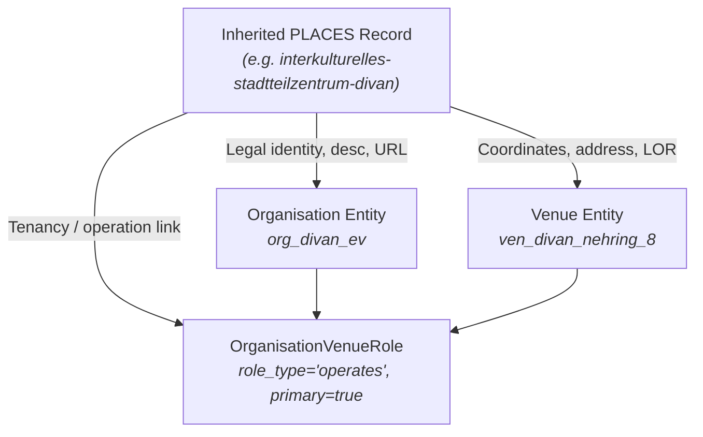
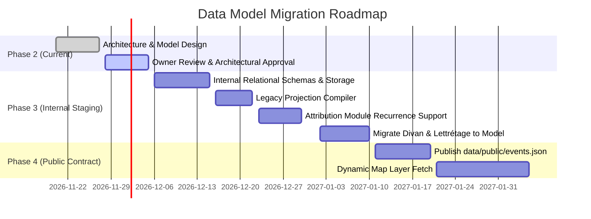

# Data Model Migration & Backward Compatibility Strategy

**Status: Proposed Specification**  
**Document:** `DATA_MODEL_MIGRATION.md`  
**Part of:** Architecture Design for Berlin Kiez Events Atlas

---

## 1. Migration Strategy Evaluation

The Berlin Kiez Events Atlas must evolve without breaking the working frontend (`index.html`), invalidating the 46 machine-enforced validation checks (`kiez_atlas.cli validate`), or disrupting Phase 1 venue inventory data.

We evaluate three migration options:

### Option A: Canonical Internal Relational Model with Legacy Projections (RECOMMENDED)
- **Concept:** The new 4-entity model (`Organisation`, `Venue`, `OrganisationVenueRole`, `EventSeries`, `EventOccurrence`) is adopted as the **canonical internal data format** in `data/internal/`. The build pipeline (`kiez_atlas.build`) compiles these entities into the exact legacy formats expected by existing consumers:
  1. `data/public/venues.json` (strictly conforming to `venue.schema.json` v0.3.0).
  2. `index.html` embedded `window.ATLAS.PLACES` array (strictly byte-checked by `validate.py`).
  3. `data/public/events.json` (new public endpoint for events).
- **Pros:**
  - Zero risk of frontend breakage.
  - `cli validate` (all 46 checks) and CI workflows remain 100% green without modification.
  - Allows full internal relational modeling of multi-venue organisations and recurring series immediately.
- **Cons:** Requires compilation/projection scripts to maintain legacy output shape.

### Option B: Direct Replacement of Existing Structures
- **Concept:** Immediately replace `data/public/venues.json`, `data/internal/venue_inventory.json`, and `index.html` with the new relational schema.
- **Pros:** Eliminates legacy translation code.
- **Cons:** **FATAL.** Violates non-negotiable project boundaries. Breaks `index.html` (3.26 MB inline JS blob), fails the byte-identity integrity check (`927d63a91919`), and causes CI to immediately fail. Completely unviable.

### Option C: Staged Hybrid Approach (Phased Evolution)
- **Concept:** Adopt Option A immediately (Internal Canonical + Legacy Projection). When the frontend is upgraded in a future phase (e.g. Phase 4 or 5) to load data dynamically via `fetch("data/public/venues.json")` and `fetch("data/public/events.json")`, modernize the public JSON contracts to v0.4.0.
- **Recommendation:** **Adopt Strategy A now, with Strategy C as the official long-term roadmap.**

---

## 2. Field Defect Audit: Ambiguous, Insufficient, and Incorrectly Modelled Fields

Before mapping fields, we document exactly what is wrong with the existing schemas:

| Defective Field | Location | Root Cause Defect | Architectural Remedy |
|---|---|---|---|
| **`venue_id`** | `PLACES[].id`<br/>`venues.json`<br/>`venue_inventory.json` | **Conflation of entity and place.** For example, `interkulturelles-stadtteilzentrum-divan` refers simultaneously to the e.V. association and the building at Nehringstr. 8. When Divan operates Nehringstr. 26, the ID cannot represent both. | Split into canonical `org_divan_ev` and two venues: `ven_divan_nehring_8` and `ven_divan_nehring_26`. Legacy `venue_id` is preserved as an alias/pointer for backward compatibility. |
| **`website`** | `venues.json`<br/>`venue_inventory.json` | **Assumes 1 website per venue.** In reality, `https://www.nachbarschaftszentrum-divan.de` belongs to the *organisation*, not the brick-and-mortar building. | Relocate official domain to `Organisation.website`. `Venue` only carries a website if a specific venue landing page exists (e.g. room booking page). |
| **`event_listing_url`** | `PHASE2_SOURCE_REGISTRY.json` | **Source anchored to single venue.** `p2-006` ties `https://nachbarschaftszentrum-divan.de/kalender/` exclusively to `venue_id: "interkulturelles-stadtteilzentrum-divan"`. Because the calendar contains events for both buildings, attribution fails. | `EventSource` records link to `organisation_id` (`org_divan_ev`). The scraper yields candidate occurrences whose individual locations are attributed dynamically. |
| **`venue_name` / `lor_id` on Events** | `docs/feasibility/artifacts/event.schema.json` | **Denormalisation without series abstraction.** Flatly stamps `venue_name`, `lor_id`, and `lor_name` directly onto each occurrence, with no series grouping, no multi-venue support, and no occurrence revision history. | Separate `EventSeries` from `EventOccurrence`. Occurrences reference `venue_id`; LOR geography is joined on `Venue.lor_id` rather than duplicated. |
| **`atlas_provenance`** | `venues.json` | **One-way frozen provenance.** Preserves `PLACES[].src` verbatim but provides no way to cite official district registers or Impressum verification. | Add `Organisation.source_references` and `Venue.source_references` with explicit observation timestamps and verification tiers. |

---

## 3. Comprehensive Migration Mapping Tables

### 3.1 Inherited `PLACES` $\rightarrow$ Proposed `Organisation`, `Venue`, and `Role`

Each record in the inherited 303-item inventory is decomposed as follows:



| Inherited Field (`PLACES[]`) | Proposed Target Entity & Field | Transformation / Migration Rule |
|---|---|---|
| `id` (e.g. `interkulturelles-...`) | `Venue.legacy_atlas_id`<br/>`Venue.venue_id`<br/>`Organisation.organisation_id` | Preserved verbatim in `legacy_atlas_id`. Generated into `ven_{slug}` and `org_{slug}`. |
| `name` (e.g. `Interkulturelles...`) | `Organisation.canonical_name`<br/>`Venue.canonical_name` | Name assigned to both; human review can refine organisation legal name vs building name. |
| `cat` (e.g. `community`) | `Venue.venue_type`<br/>`Venue.legacy_cat` | Mapped via `vocab.VENUE_TYPES` dictionary. Original preserved in legacy block. |
| `layer` (e.g. `social`) | `Venue.legacy_layer` | Retained for backward-compatible rendering. |
| `desc` | `Organisation.description`<br/>`Venue.description` | Text assigned to organisation description by default. |
| `address` (e.g. `Nehringstraße 8`) | `Venue.address.street`<br/>`Venue.address.house_number` | Parsed via `kiez_atlas.attribution.VenueAddress.parse()`. |
| `plz` (e.g. `14059`) | `Venue.address.postcode` | Transferred to structured address block. |
| `d` (e.g. `Charlottenburg-...`) | `Venue.address.district` | Transferred to structured address block. |
| `c` (e.g. `[13.29375, 52.51654]`) | `Venue.coordinates.longitude`<br/>`Venue.coordinates.latitude` | Inverted from GeoJSON `[lon, lat]` to explicit fields. |
| `lor` (e.g. `04300413`) | `Venue.lor_plr_id`<br/>`Venue.lor_id` | 8-digit PLR preserved; 6-digit BZR derived via id prefix. |
| `url` | `Organisation.website.url` | Assigned to organisation website with `verification: "unverified"`. |
| `src` | `Organisation.source_references` | Recorded as initial Phase 1 ingestion provenance. |

---

### 3.2 Legacy `public/venues.json` Projection (Backward Compatibility Contract)

The projection compiler `pipelines/src/kiez_atlas/compile_legacy_venues.py` reconstructs `data/public/venues.json` (schema v0.3.0) from the relational entities with **100% byte and schema fidelity**:

```python
def project_legacy_venue(venue: Venue, org: Organisation, role: OrganisationVenueRole) -> dict:
    """Projects internal relational entities into the public venue.schema.json v0.3.0 format."""
    return {
        "schema_version": "0.3.0",
        "venue_id": venue.legacy_atlas_id or venue.venue_id.replace("ven_", ""),
        "venue_name": venue.canonical_name,
        "venue_type": venue.venue_type,
        "community_relevance": venue.community_relevance,
        "latitude": venue.coordinates["latitude"],
        "longitude": venue.coordinates["longitude"],
        "address": f"{venue.address['street']} {venue.address['house_number']}",
        "plz": venue.address["postcode"],
        "district": venue.address["district"],
        "lor_id": venue.lor_id,
        "lor_name": venue.lor_name,
        "lor_plr_id": venue.lor_plr_id,
        "coordinate_precision": venue.coordinate_precision,
        "website": {
            "url": org.website.get("url"),
            "kind": "venue_site_unverified",
            "verification": org.website.get("verification_status", "unverified"),
            "shared_by_venue_count": 1
        },
        "atlas_provenance": {
            "source_reference": venue.source_references[0]["reference_url"] if venue.source_references else "",
            "atlas_category": venue.legacy_cat,
            "atlas_layer": venue.legacy_layer
        }
    }
```

---

### 3.3 Event Source Registry Migration (`PHASE2_SOURCE_REGISTRY`)

In the existing source registry, sources link only to `venue_id`. The migration updates the registry schema to support organisation feeds:

| Existing Registry Field | Proposed Registry Field | Meaning |
|---|---|---|
| `source_id` (e.g. `p2-006`) | `source_id` | Unchanged unique source identifier. |
| `venue_id` (e.g. `interkulturelles-...`) | `target_entity_type`<br/>`target_entity_id` | `target_entity_type = "organisation"`, `target_entity_id = "org_divan_ev"`. |
| `event_listing_url` | `event_listing_url` | URL scraped or fetched. |
| `source_status` | `source_status` | From `vocab.EVENT_SOURCE_STATUS` (`qualified_with_filter`). |
| `evidence` | `evidence` | Unchanged audit trail. |

---

## 4. Phased Implementation Roadmap



### Phase 2: Design Approval (Current Step)
- Deliver complete architecture specifications in `docs/architecture/`.
- No code or production data touched.

### Phase 3: Internal Canonical Model & Projection Compiler
- Create `pipelines/src/kiez_atlas/models/` dataclasses.
- Generate canonical `organisations.json`, `venues.json`, `organisation_venue_roles.json` in `data/internal/`.
- Build `compile_legacy_venues.py` to ensure `data/public/venues.json` remains byte-identical.
- Run `cli validate` to prove 0 regressions.

### Phase 4: Event Pipeline Integration
- Incorporate `EventSeries` and `EventOccurrence` generators.
- Publish `data/public/events.json` according to the new `occurrence.schema.json`.
- Add `data/public/events.json` to `data/deploy-allowlist.txt`.

---

## 5. Risk Assessment & Rollback Strategy

| Identified Risk | Severity | Mitigation Strategy | Rollback Procedure |
|---|---|---|---|
| **Compilation Drift:** Legacy `venues.json` drifted by a key or space. | High | Automated git diff check in CI (`git diff --exit-code data/public/venues.json`). | Revert internal build script; restore committed `venues.json` from git. |
| **Frontend Map Rendering Discrepancy:** Markers render differently. | Critical | `index.html` is byte-locked against git hash `927d63a91919`. The pipeline cannot modify it. | Instant CI failure if `index.html` hash shifts. |
| **Loss of Source Provenance:** Historical Phase 1 origin URLs lost. | Medium | All legacy fields preserved in `Venue.legacy_atlas_id` and `atlas_provenance`. | Audit against committed `data/internal/venue_inventory.json`. |
| **Over-Segmentation of Venues:** Creating too many micro-venues confuses users. | Medium | Venues must have `has_map_marker: true` only if they represent independent physical street entrances. | Sub-venues collapse under `parent_venue_id`. |
