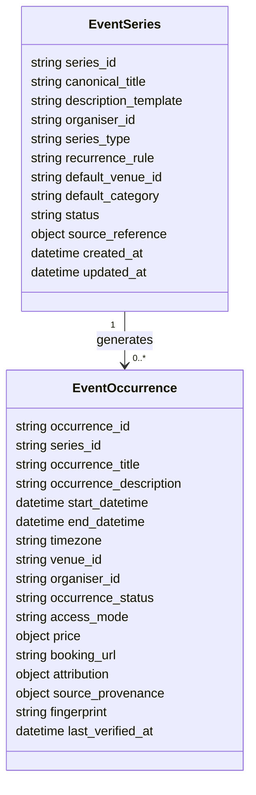

# Event Series & Occurrence Data Model

**Status: Proposed Specification**  
**Document:** `EVENT_SERIES_OCCURRENCE_MODEL.md`  
**Part of:** Architecture Design for Berlin Kiez Events Atlas

---

## 1. Motivation: Why Separate Series from Occurrences?

In Phase 2, the Divan audit examined 221 calendar records and made a striking discovery:
- **221 records** correspond to only **58 distinct event titles**.
- **220 of the 221 records** are recurring instances of weekly or bi-weekly community groups.
- The busiest single title at the mapped venue occurs **9 times in a single month**.
- **85 of the 175 mapped occurrences** had already passed relative to the observation date.
- **Zero individual event permalinks** exist in the source HTML.

If an atlas publishes raw calendar extractions directly to a map:
1. **Map Clutter & Visual Overlap:** 9 identical pins are placed on top of each other at the same building for one recurring knitting circle or language café.
2. **Expired Garbage:** Expired events remain visible or silently inflate activity metrics unless filtered by an explicit cutoff.
3. **Loss of Programme Identity:** When a weekly workshop changes its guest teacher or slightly edits its weekly subtitle, a flat model treats it as a brand-new, unrelated event.
4. **Rescheduling & Cancellation Impossibility:** If one specific Tuesday session is cancelled due to illness, a flat model either deletes the entire event or leaves the cancelled session active.

### The Foundational Separation
```
EventSeries (Conceptual Programme)
└── Canonical title, conceptual description, primary organiser, default recurrence rule (RRULE)
    ├── Occurrence 1: 2026-11-03 14:00–16:00 @ Venue 8 (Status: Completed)
    ├── Occurrence 2: 2026-11-10 14:00–16:00 @ Venue 8 (Status: Completed)
    ├── Occurrence 3: 2026-11-17 14:00–16:00 @ Venue 26 (Status: Relocated to Sibling Building)
    ├── Occurrence 4: 2026-11-24 14:00–16:00 @ Venue 8 (Status: Cancelled - Illness)
    └── Occurrence 5: 2026-12-01 14:00–16:00 @ Venue 8 (Status: Scheduled)
```

---

## 2. Entity Definitions & Field Allocation

The division of fields between `EventSeries` and `EventOccurrence` is strict:



### Allocation Rules: Which Field Belongs Where?

| Field | Belongs to | Justification |
|---|---|---|
| **`canonical_title`** | **Series** | The overarching name of the programme (e.g. *"Sprachcafé Deutsch"*). |
| **`occurrence_title`** | **Occurrence** | Optional override if a specific date has a special topic (e.g. *"Sprachcafé Deutsch: Spezial Bewerbungstraining"*). Defaults to series title if null. |
| **`description`** | **Both** | Series holds the general format description; Occurrence holds date-specific session notes. |
| **`start_datetime` / `end_datetime`** | **Occurrence** | Time is physical and concrete. A series has no single start time; it has a recurrence pattern. |
| **`timezone`** | **Occurrence** | Always explicitly pinned to `"Europe/Berlin"` (to prevent UTC offset shifting bugs). |
| **`venue_id`** | **Both (Default vs Concrete)** | Series holds `default_venue_id`. Occurrence holds the verified physical venue for that specific date. (Allows session 3 to be held in Room B or Sibling Building). |
| **`status`** | **Both** | Series status: `active`, `hiatus`, `concluded`. Occurrence status: `scheduled`, `cancelled`, `postponed`, `moved`. |
| **`price` & `booking_url`** | **Occurrence** | Ticket prices and ticketing links are inherently date-specific (e.g. special holiday entry fee or Sold Out status). |
| **`attribution`** | **Occurrence** | Provenance and physical venue matching is evaluated per occurrence. |

---

### 2.1 The `EventSeries` Schema (`series.schema.json` draft)

```json
{
  "$schema": "https://json-schema.org/draft/2020-12/schema",
  "title": "Kiez Events Atlas – Event Series Record",
  "type": "object",
  "required": [
    "schema_version",
    "series_id",
    "canonical_title",
    "organiser_id",
    "series_type",
    "status",
    "created_at",
    "updated_at"
  ],
  "additionalProperties": false,
  "properties": {
    "schema_version": { "const": "0.4.0" },
    "series_id": {
      "type": "string",
      "pattern": "^srs_[a-z0-9_\\-]{3,60}$",
      "description": "Stable hash of (organiser_id, normalized_title, recurrence_pattern)."
    },
    "canonical_title": {
      "type": "string",
      "minLength": 1,
      "maxLength": 300
    },
    "title_variants": {
      "type": "array",
      "items": { "type": "string" },
      "description": "Historical or alternate spellings encountered across sources."
    },
    "description_template": {
      "type": ["string", "null"],
      "maxLength": 4000
    },
    "organiser_id": {
      "type": "string",
      "pattern": "^org_"
    },
    "default_venue_id": {
      "type": ["string", "null"],
      "pattern": "^ven_",
      "description": "Usual physical venue. Null if the series moves or is online."
    },
    "series_type": {
      "enum": [
        "weekly_group",       // Meets every week (e.g. Sprachcafé, Yoga)
        "biweekly_group",     // Meets every two weeks
        "monthly_event",      // Meets monthly (e.g. Repair Café)
        "workshop_course",    // Multi-week course with fixed cohort
        "festival_curation",  // Annual or multi-day themed festival
        "exhibition_run",     // Continuous multi-week gallery run
        "irregular_series"    // Recurring format with ad-hoc scheduling
      ]
    },
    "recurrence_rule": {
      "type": ["string", "null"],
      "description": "RFC 5545 RRULE string if deterministic (e.g. 'FREQ=WEEKLY;BYDAY=TU')."
    },
    "default_category": {
      "enum": [
        "community_meal", "neighbourhood_gathering", "repair_cafe",
        "sustainability", "arts_culture", "language_exchange",
        "civic_participation", "sport_outdoor", "participatory_workshop",
        "counselling_advice", "other_review"
      ]
    },
    "status": {
      "enum": ["active", "on_hiatus", "concluded", "pending_verification"]
    },
    "source_references": {
      "type": "array",
      "items": {
        "type": "object",
        "required": ["source_id", "source_url", "first_seen"],
        "properties": {
          "source_id": { "type": "string" },
          "source_url": { "type": "string", "format": "uri" },
          "first_seen": { "type": "string", "format": "date" }
        }
      }
    },
    "created_at": { "type": "string", "format": "date-time" },
    "updated_at": { "type": "string", "format": "date-time" }
  }
}
```

---

### 2.2 The `EventOccurrence` Schema (`occurrence.schema.json` draft)

```json
{
  "$schema": "https://json-schema.org/draft/2020-12/schema",
  "title": "Kiez Events Atlas – Event Occurrence Record",
  "type": "object",
  "required": [
    "schema_version",
    "occurrence_id",
    "series_id",
    "title",
    "start_datetime",
    "end_datetime",
    "timezone",
    "venue_id",
    "organiser_id",
    "access_mode",
    "price",
    "occurrence_status",
    "attribution",
    "source_provenance",
    "fingerprint",
    "last_verified_at"
  ],
  "additionalProperties": false,
  "properties": {
    "schema_version": { "const": "0.4.0" },
    "occurrence_id": {
      "type": "string",
      "pattern": "^occ_[a-z0-9_\\-]{3,64}$",
      "description": "Stable deterministic hash of (series_id || canonical_title, start_datetime, venue_id)."
    },
    "series_id": {
      "type": ["string", "null"],
      "description": "Pointer to parent EventSeries. NULL only for genuine one-off standalone events."
    },
    "title": {
      "type": "string",
      "minLength": 1,
      "maxLength": 300,
      "description": "Display title for this concrete occurrence."
    },
    "description": {
      "type": ["string", "null"],
      "maxLength": 4000
    },
    "start_datetime": {
      "type": "string",
      "format": "date-time",
      "description": "ISO-8601 with explicit Berlin offset (e.g. '2026-11-17T14:00:00+01:00')."
    },
    "end_datetime": {
      "type": "string",
      "format": "date-time",
      "description": "ISO-8601 with explicit Berlin offset."
    },
    "timezone": {
      "const": "Europe/Berlin",
      "description": "Always Europe/Berlin. Never UTC, to prevent DST transition discrepancies."
    },
    "venue_id": {
      "type": ["string", "null"],
      "description": "Physical venue where occurrence takes place. Null if online or unresolvable."
    },
    "room_note": {
      "type": ["string", "null"],
      "maxLength": 100,
      "description": "Specific room inside venue, e.g. 'Raum 3', 'Gartensaal', 'Hinterhof'."
    },
    "organiser_id": {
      "type": "string",
      "pattern": "^org_"
    },
    "access_mode": {
      "enum": ["physical_in_person", "online_virtual", "hybrid"]
    },
    "category": {
      "type": "string",
      "description": "From vocab.EVENT_CATEGORIES."
    },
    "price": {
      "type": "object",
      "required": ["price_status", "currency"],
      "additionalProperties": false,
      "properties": {
        "price_status": {
          "enum": ["free", "donation", "fixed_price", "price_range", "unknown"]
        },
        "amount_min": { "type": ["number", "null"], "minimum": 0 },
        "amount_max": { "type": ["number", "null"], "minimum": 0 },
        "currency": { "const": "EUR" },
        "is_under_20_eur": { "type": ["boolean", "null"] },
        "price_note": { "type": ["string", "null"], "maxLength": 200 }
      }
    },
    "booking_url": { "type": ["string", "null"], "format": "uri" },
    "occurrence_status": {
      "enum": [
        "scheduled",   // Active, published
        "rescheduled", // Moved to a new start/end time (points to new occurrence)
        "postponed",   // Date temporarily unknown
        "moved_venue", // Shifted to another physical building
        "cancelled",   // Explicitly cancelled by organiser
        "quarantined"  // Under human review due to data conflict
      ]
    },
    "attribution": {
      "type": "object",
      "required": [
        "classification",
        "site_relationship",
        "evidence_type",
        "is_publishable_at_venue",
        "requires_human_review"
      ],
      "additionalProperties": false,
      "properties": {
        "classification": {
          "enum": ["hosted", "organised_elsewhere", "partnered", "external_event", "ambiguous", "insufficient_data"]
        },
        "site_relationship": {
          "enum": ["mapped_venue", "sibling_site", "external_site", "unknown"]
        },
        "evidence_type": {
          "enum": ["strong_address_match", "supporting_programme_page", "weak_text_only", "none"]
        },
        "matched_address_text": { "type": ["string", "null"] },
        "conflicting_evidence": { "type": ["string", "null"] },
        "is_publishable_at_venue": { "type": "boolean" },
        "requires_human_review": { "type": "boolean" }
      }
    },
    "source_provenance": {
      "type": "object",
      "required": [
        "source_id",
        "source_url",
        "extraction_method",
        "retrieved_at"
      ],
      "additionalProperties": false,
      "properties": {
        "source_id": { "type": "string" },
        "source_event_id": { "type": ["string", "null"] },
        "source_url": { "type": "string", "format": "uri" },
        "extraction_method": { "type": "string" },
        "retrieved_at": { "type": "string", "format": "date-time" },
        "raw_hash": { "type": "string", "description": "SHA-256 of raw scraped payload fragment" }
      }
    },
    "fingerprint": {
      "type": "string",
      "description": "Deterministic semantic hash for cross-source deduplication."
    },
    "last_verified_at": { "type": "string", "format": "date-time" }
  }
}
```

---

## 3. Stable Identity & Deduplication Engine

A critical requirement of the system is that identifiers must not break when a webpage changes layout, a title is slightly reworded, or an event moves rooms.

### 3.1 Four Tiers of Identifiers

```
1. Internal Canonical ID (e.g. occ_divan_yoga_20261117_1400)
   - Immutable primary key inside the Atlas.
   - Assigned once; never reused.

2. Source-Specific ID (e.g. p2-006:simcal-event-3138)
   - Native identifier emitted by the publisher's system (e.g. WP post ID, RSS guid).
   - Fragile: disappears if the publisher rebuilds their CMS.

3. Semantic Matching Fingerprint (e.g. fp_7b3a19e2...)
   - Normalized digest: SHA-256(fold_title + start_datetime + postal_code).
   - Used for conservative duplicate detection across different scrapers.

4. Human-Reviewed Curatorial Match
   - Manual override recorded in data/internal/review_queue.json.
```

---

### 3.2 Canonical ID Derivation Algorithms

#### 1. Organisation ID
$$\text{organisation\_id} = \text{"org\_"} + \text{slugify}(\text{canonical\_name})$$
*Example:* `"Nachbarschaftszentrum Divan e.V."` $\rightarrow$ `org_divan_ev`.  
If a legal name changes, `aliases` records the historical names, but `organisation_id` remains unchanged.

#### 2. Venue ID
$$\text{venue\_id} = \text{"ven\_"} + \text{slugify}(\text{name}) + \text{"\_"} + \text{slugify}(\text{street}) + \text{"\_"} + \text{house\_number}$$
*Example:* `ven_divan_nehring_8`, `ven_divan_nehring_26`.  
*Property:* Anchored to the physical address, ensuring stability even if the tenant or building nickname changes.

#### 3. Event Series ID
$$\text{series\_id} = \text{"srs\_"} + \text{slugify}(\text{organiser\_short}) + \text{"\_"} + \text{slugify}(\text{normalized\_title})$$
*Example:* `srs_divan_yoga_stuhl`.  
*Property:* Independent of start times and venue shifts.

#### 4. Event Occurrence ID
$$\text{occurrence\_id} = \text{"occ\_"} + \text{series\_slug} + \text{"\_"} + \text{YYYYMMDD\_HHMM}$$
*Example:* `occ_divan_yoga_stuhl_20261117_1000`.  
For standalone events:
$$\text{occurrence\_id} = \text{"occ\_"} + \text{short\_hash}(\text{source\_url} + \text{normalized\_title}) + \text{"\_"} + \text{YYYYMMDD\_HHMM}$$

---

### 3.3 What Happens When Real-World Changes Occur?

| Scenario | Behaviour in Data Model | ID Impact |
|---|---|---|
| **A publisher updates the website URL** | `EventSource.url` is updated. Scraped records retain their existing `occurrence_id` because identity is anchored to semantic fields, not the scraped URL. | No ID change. |
| **A venue changes its brand name** | `Venue.canonical_name` is updated. `Venue.aliases` appends the old name. `venue_id` remains `ven_divan_nehring_8`. | No ID change. |
| **A recurring event moves to another building** | For that date, `EventOccurrence.venue_id` changes from `ven_nehring_8` to `ven_nehring_26`. The parent `series_id` is untouched. The occurrence's `attribution.site_relationship` flips to `sibling_site`. | `occurrence_id` unchanged; attribution reflects real place. |
| **An occurrence title has a typo fixed** | Minor title adjustments (Levenshtein distance < 15%) update `occurrence_title` without altering `occurrence_id`. Major changes enter review queue. | No ID change. |
| **An event is cancelled** | `occurrence_status` is updated to `"cancelled"`. The record is retained (not deleted), allowing the frontend to show a strike-through or badge rather than silently vanishing. | No ID change. |
| **Two sources describe the same event** | The semantic fingerprint matches. The records merge: Primary occurrence retains `occurrence_id`; secondary source is added to `source_provenance.secondary_sources`. | Merged into single occurrence. |
| **Identical duplicate records in same source** | Like Divan's single symmetric duplicate (220 distinct tuples, 221 records), the ingestion engine counts occurrences via multiset logic and rejects redundant identical duplicates. | Redundant duplicate dropped. |

---

## 4. Complex Recurrence & Edge Case Handling

### 4.1 Series That Continue Indefinitely
Most community centres run open weekly groups with no end date (e.g. *"Every Wednesday 14:00–16:00"*).
- **Rule:** The pipeline maintains a **Rolling 60-Day Forward Horizon**.
- Occurrences are projected up to `now() + 60 days`. Occurrences past `now() - 30 days` are archived.
- No infinite database rows are generated.

### 4.2 Multi-Day Festivals with No Per-Day Schedule
When a street festival announces *"May 15–17, 10:00–22:00"*:
- Modeled as an `EventSeries(series_type="festival_curation")` with 3 concrete `EventOccurrence` records (one per date), each with its own `start_datetime` and `end_datetime`.
- Prevents multi-day events from rendering as a single 72-hour continuous block.

### 4.3 Multi-Venue Ambiguity Resolution
When an event listing states *"Nehringstr. 8 / Nehringstr. 26"*:
- The occurrence is created with:
  - `venue_id: null`
  - `attribution.classification: "ambiguous"`
  - `attribution.is_publishable_at_venue: false`
  - `occurrence_status: "quarantined"`
- The record enters `data/internal/review_queue.json`. A human editor can assign the correct building. Until reviewed, it is **never published** at either marker.
