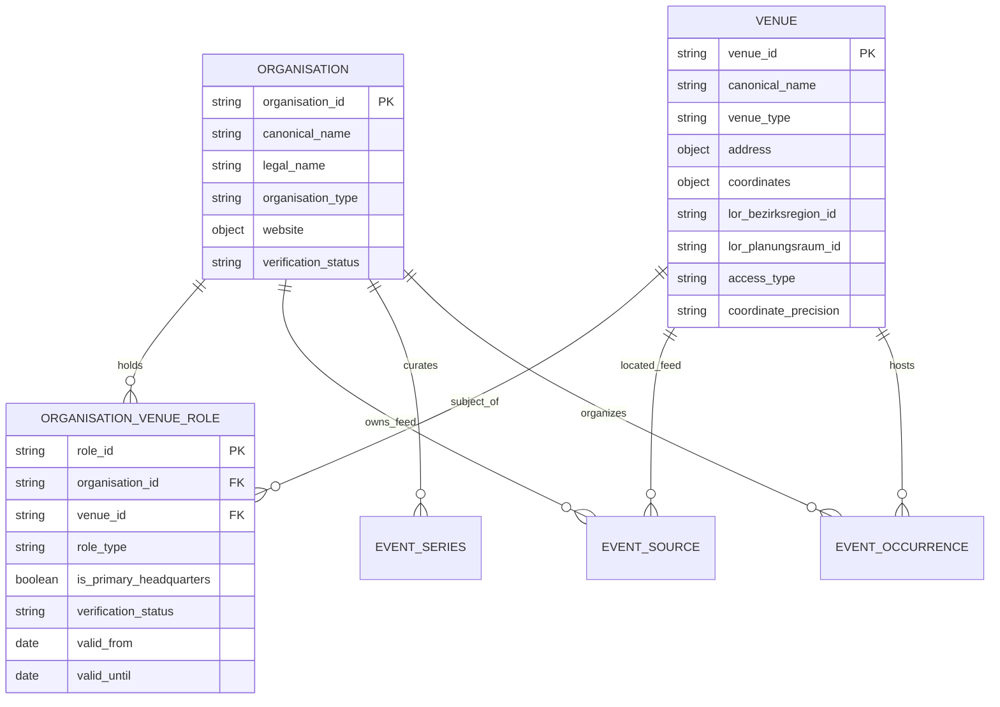

# Organisation & Venue Data Model

**Status: Proposed Specification**  
**Document:** `ORGANISATION_VENUE_MODEL.md`  
**Part of:** Architecture Design for Berlin Kiez Events Atlas

---

## 1. Motivation: Why Decouple Organisations from Venues?

In the inherited CCI Atlas data model, everything is conflated into a single flat array called `PLACES`:
```json
{
  "id": "interkulturelles-stadtteilzentrum-divan",
  "name": "Interkulturelles Stadtteilzentrum Divan",
  "address": "Nehringstraße 8",
  "url": "https://www.nachbarschaftszentrum-divan.de",
  "c": [13.29375, 52.51654]
}
```
This flat record merges three fundamentally different concepts into one:
1. **The Legal & Community Entity:** *Nachbarschaftszentrum Divan e.V.*, a registered non-profit organisation that administers programmes, employs staff, runs a website, and publishes an event calendar.
2. **The Physical Venue 1 (Primary Hub):** *Nehringstraße 8, 14059 Berlin*, a physical building with distinct street coordinates, rooms, and LOR planning identifiers (PLR `04300413`, BZR `043004`).
3. **The Physical Venue 2 (Sibling Building):** *Nehringstraße 26, 14059 Berlin*, another physical building 200 metres down the same street operated by the same association.

### Real-World Failure Modes Observed in Phase 2
- **Sibling-Building Contamination:** Divan's calendar hosts 36 events at Nehringstr. 26. In a single-entity model, these 36 events are published at the marker for Nehringstr. 8. A user arriving at the map pin arrives at the wrong building.
- **Ambiguous Multi-Venue Descriptions:** 9 calendar events named both buildings. Without separating the organisation from each building, the pipeline cannot express "organised by Divan, but physical location is unconfirmed between Venue A and Venue B".
- **Co-located Organisations (The Silent Green Problem):** *Gerichtstraße 35* (silent green Kulturquartier) houses *Musicboard Berlin GmbH* (`cat: funding`), *Harun Farocki Institut*, *SAVVY Contemporary*, and independent artist studios. Forcing each organisation to be its own independent physical venue duplicates physical coordinates and fragments neighbourhood geography. Conversely, forcing the building to be the sole entity erases the distinct organisations producing the events.
- **Off-Site / Partner Events:** Cultural hubs frequently organise neighbourhood street festivals, park cleanups (e.g. Klausenerplatz), or collaborative readings at partner bookshops. An organisation-level event source published raw will place park events inside the office building.
- **Online / Virtual Events:** Many community advice centres run digital legal aid or language exchanges with no physical venue.

---

## 2. Entity Definitions

The proposed model introduces three first-class entities:



---

### 2.1 The `Organisation` Entity

An `Organisation` represents a cultural, civic, commercial, or public entity that organises, curates, sponsors, or operates cultural and community programmes.

#### Schema (`organisation.schema.json` draft)
```json
{
  "$schema": "https://json-schema.org/draft/2020-12/schema",
  "title": "Kiez Events Atlas – Organisation Record",
  "type": "object",
  "required": [
    "schema_version",
    "organisation_id",
    "canonical_name",
    "organisation_type",
    "verification_status",
    "created_at",
    "updated_at"
  ],
  "additionalProperties": false,
  "properties": {
    "schema_version": { "const": "0.4.0" },
    "organisation_id": {
      "type": "string",
      "pattern": "^org_[a-z0-9_\\-]{3,50}$",
      "description": "Stable canonical identifier (e.g. 'org_divan_ev', 'org_lettretage_ev')."
    },
    "canonical_name": {
      "type": "string",
      "minLength": 1,
      "maxLength": 200,
      "description": "Common public-facing name (e.g. 'Nachbarschaftszentrum Divan e.V.')."
    },
    "legal_name": {
      "type": ["string", "null"],
      "maxLength": 200,
      "description": "Official registered name (e.g. 'Interkulturelles Stadtteilzentrum, Nachbarschaftszentrum Divan e.V.')."
    },
    "aliases": {
      "type": "array",
      "items": { "type": "string" },
      "uniqueItems": true,
      "description": "Known alternate names and acronyms used in event descriptions (e.g. ['Divan', 'NBZ Divan'])."
    },
    "organisation_type": {
      "type": "string",
      "enum": [
        "registered_association",  // Eingetragener Verein (e.V.)
        "nonprofit_company",      // gGmbH
        "commercial_company",     // GmbH, UG
        "public_institution",     // Public library, district office, municipal centre
        "informal_collective",    // Initiative, activist network without legal wrapper
        "religious_community",    // Mosque, church, parish community
        "unknown"
      ]
    },
    "description": {
      "type": ["string", "null"],
      "maxLength": 2000
    },
    "website": {
      "type": "object",
      "required": ["url", "verification_status"],
      "additionalProperties": false,
      "properties": {
        "url": { "type": ["string", "null"], "format": "uri" },
        "verification_status": {
          "enum": ["verified_official", "unverified", "third_party_directory"]
        }
      }
    },
    "email": { "type": ["string", "null"], "format": "email" },
    "phone": { "type": ["string", "null"] },
    "verification_status": {
      "enum": ["verified", "provisional", "pending_review", "deprecated"]
    },
    "source_references": {
      "type": "array",
      "items": {
        "type": "object",
        "required": ["source_name", "reference_url", "observed_at"],
        "properties": {
          "source_name": { "type": "string" },
          "reference_url": { "type": "string", "format": "uri" },
          "observed_at": { "type": "string", "format": "date" }
        }
      }
    },
    "created_at": { "type": "string", "format": "date-time" },
    "updated_at": { "type": "string", "format": "date-time" }
  }
}
```

---

### 2.2 The `Venue` Entity

A `Venue` represents an immutable physical space or building on the surface of the earth. A venue has physical coordinates, postal addresses, and LOR planning units. It does **not** assume an exclusive operator.

#### Schema (`venue.schema.json` v0.4.0 draft)
```json
{
  "$schema": "https://json-schema.org/draft/2020-12/schema",
  "title": "Kiez Events Atlas – Physical Venue Record",
  "type": "object",
  "required": [
    "schema_version",
    "venue_id",
    "canonical_name",
    "venue_type",
    "address",
    "coordinates",
    "coordinate_precision",
    "lor_id",
    "lor_plr_id",
    "verification_status",
    "created_at",
    "updated_at"
  ],
  "additionalProperties": false,
  "properties": {
    "schema_version": { "const": "0.4.0" },
    "venue_id": {
      "type": "string",
      "pattern": "^ven_[a-z0-9_\\-]{3,50}$",
      "description": "Stable canonical venue identifier (e.g. 'ven_divan_nehring_8', 'ven_divan_nehring_26')."
    },
    "legacy_atlas_id": {
      "type": ["string", "null"],
      "description": "Pointer to inherited PLACES[].id for 100% backward compatibility (e.g. 'interkulturelles-stadtteilzentrum-divan')."
    },
    "canonical_name": {
      "type": "string",
      "minLength": 1,
      "maxLength": 200,
      "description": "Primary physical building name (e.g. 'Divan Stadtteilzentrum (Nehringstr. 8)')."
    },
    "aliases": {
      "type": "array",
      "items": { "type": "string" },
      "uniqueItems": true,
      "description": "Building aliases or historical names (e.g. ['Alte Feuerwache', 'Kulturquartier silent green'])."
    },
    "venue_type": {
      "type": "string",
      "description": "From vocab.VENUE_TYPES (e.g. 'community_centre', 'library', 'cultural_centre', 'public_space', 'cafe_bar')."
    },
    "access_type": {
      "enum": ["public_building", "private_space", "open_air_public_park", "commercial", "restricted"],
      "default": "public_building"
    },
    "address": {
      "type": "object",
      "required": ["street", "house_number", "postcode", "city"],
      "additionalProperties": false,
      "properties": {
        "street": { "type": "string" },
        "house_number": { "type": "string" },
        "building_part": { "type": ["string", "null"], "description": "e.g. 'Hof 2, Aufgang B', 'Saal', 'EG'" },
        "postcode": { "type": "string", "pattern": "^[0-9]{5}$" },
        "city": { "type": "string", "default": "Berlin" },
        "district": { "type": "string", "description": "Administrative district (Bezirk), e.g. 'Charlottenburg-Wilmersdorf'" }
      }
    },
    "coordinates": {
      "type": "object",
      "required": ["latitude", "longitude"],
      "additionalProperties": false,
      "properties": {
        "latitude": { "type": "number", "minimum": 52.3, "maximum": 52.7 },
        "longitude": { "type": "number", "minimum": 13.0, "maximum": 13.8 }
      }
    },
    "coordinate_precision": {
      "enum": ["exact_building", "street_interpolated", "postal_code_centroid", "provisional_manual"]
    },
    "lor_id": {
      "type": "string",
      "pattern": "^[0-9]{6}$",
      "description": "6-digit LOR Bezirksregion id (e.g. '043004')."
    },
    "lor_name": { "type": "string" },
    "lor_plr_id": {
      "type": "string",
      "pattern": "^[0-9]{8}$",
      "description": "8-digit LOR Planungsraum id (e.g. '04300413')."
    },
    "has_map_marker": {
      "type": "boolean",
      "default": true,
      "description": "Whether this physical venue should render as an independent marker on the map."
    },
    "parent_venue_id": {
      "type": ["string", "null"],
      "description": "If this venue is a room/sub-venue inside a complex (e.g. 'ven_silent_green_betonhalle' inside 'ven_silent_green')."
    },
    "verification_status": {
      "enum": ["verified", "provisional", "pending_review", "excluded"]
    },
    "created_at": { "type": "string", "format": "date-time" },
    "updated_at": { "type": "string", "format": "date-time" }
  }
}
```

---

### 2.3 The `OrganisationVenueRole` (Relationship Entity)

Why is a relationship entity required rather than a single `operating_organisation_id` foreign key on `Venue`?

1. **Many-to-Many Reality:** One building (e.g. *Haus der Jugend*, *silent green*, or *Alte Feuerwache*) has an owner, a facilities manager, anchor tenant organisations, and dozens of visiting community groups. A foreign key collapses this rich hierarchy into one arbitrary entity.
2. **Temporal Validity:** Lease agreements, tenancy, and venue operators change over time. Attributing a 2024 archive event to a 2026 operator is a data integrity error.
3. **Role Specificity:** An organisation might **own** the premises (e.g. *Bezirksamt Mitte*), another might **manage** cultural bookings (e.g. a non-profit carrier association), and another might be a **resident partner** (e.g. a neighbourhood choir).

#### Schema (`organisation_venue_role.schema.json` draft)
```json
{
  "$schema": "https://json-schema.org/draft/2020-12/schema",
  "title": "Kiez Events Atlas – Organisation Venue Role Record",
  "type": "object",
  "required": [
    "role_id",
    "organisation_id",
    "venue_id",
    "role_type",
    "is_primary_headquarters",
    "verification_status",
    "evidence_type",
    "evidence_description"
  ],
  "additionalProperties": false,
  "properties": {
    "role_id": {
      "type": "string",
      "pattern": "^ovr_[a-z0-9_\\-]{3,50}$",
      "description": "Stable hash or slug of (organisation_id, venue_id, role_type)."
    },
    "organisation_id": { "type": "string", "pattern": "^org_" },
    "venue_id": { "type": "string", "pattern": "^ven_" },
    "role_type": {
      "enum": [
        "operates",             // Runs day-to-day operations and calendar
        "owns",                 // Legal property owner
        "manages_facility",     // Facility / janitorial / booking manager
        "resident_tenant",      // Permanent tenant with dedicated office/studio
        "regular_host",         // Regularly books rooms for open community meetings
        "partner",              // Strategic programme partner at this location
        "former_operator"       // Historical operator, now ended
      ]
    },
    "is_primary_headquarters": {
      "type": "boolean",
      "description": "True if this venue serves as the primary registered postal address of the organisation."
    },
    "valid_from": { "type": ["string", "null"], "format": "date" },
    "valid_until": { "type": ["string", "null"], "format": "date" },
    "verification_status": {
      "enum": ["verified", "provisional", "disputed", "deprecated"]
    },
    "evidence_type": {
      "enum": ["impressum_registration", "official_directory", "provisional_inherited", "web_prose"]
    },
    "evidence_description": {
      "type": "string",
      "maxLength": 500
    }
  }
}
```

---

## 3. Relationship Cardinality Matrix

The following table explicitly defines how every real-world relationship between Organisations and Venues is supported:

| Relationship Case | Cardinality | Implementation Mechanism | Example |
|---|---|---|---|
| **1 Org → N Venues** | $1 : N$ | One `Organisation` linked to multiple `Venue` records via `OrganisationVenueRole(role_type="operates")`. | **Divan:** Operates `ven_divan_nehring_8` and `ven_divan_nehring_26`. |
| **N Orgs → 1 Venue** | $N : 1$ | Multiple `Organisation` records linked to the same `Venue` record with distinct `role_type`s. | **Silent Green (`ven_silent_green`):** Operated by *silent green Kulturquartier GmbH*, resident tenant *Musicboard Berlin GmbH*, tenant *Harun Farocki Institut*. |
| **1 Org → Events at External Venues** | $1 : N$ | `EventOccurrence.organiser_id == org_A` while `EventOccurrence.venue_id == ven_B`. The relationship is held at the event level, not requiring a permanent venue lease. | **Lettrétage:** Reading hosted at *Haus für Poesie* or outdoor reading in *Tiergarten*. |
| **1 Venue → N Organisers** | $1 : N$ | The venue hosts occurrences curated by various organisations (`EventOccurrence.venue_id` constant, `organiser_id` varies). | **Stadtteilzentrum Steglitz:** Hosts local chess club, neighbourhood council, and refugee initiatives. |
| **1 Venue → N Event Sources** | $1 : N$ | Multiple `EventSource` records link to `venue_id`. | A municipal library whose events appear on both Berlin.de RSS and an independent Facebook/Meetup group. |
| **1 Org → N Event Sources** | $1 : N$ | Multiple `EventSource` records link to `organisation_id`. | An NGO publishing separate feeds for youth programmes, language courses, and evening concerts. |
| **Online / Virtual Events** | $1 : 0$ | `EventOccurrence.venue_id == null` and `EventOccurrence.access_mode == "online"`. | Digital legal advice workshop via Zoom. |

---

## 4. Evidence Hierarchy and Attribution Rules

How does the pipeline decide which organisation operates which venue, and where an event belongs?

Attribution must follow an strict, unyielding evidence hierarchy:

```
[ Tier 1: Strong Evidence ] (Can establish positive attribution)
├── Exact street name + exact house number in location text matching Venue.address
└── Official Impressum or legal register naming the building as premises

[ Tier 2: Supporting Evidence ] (Cannot establish venue location on its own)
├── Organiser / partner mention in text (says WHO runs it, NOT WHERE it is)
└── Feed origin (e.g. calendar hosted on organisation website)

[ Tier 3: Weak / Deliberately Rejected Evidence ] (Must NEVER establish venue placement)
├── Venue name in event title (marketing text, e.g. "Divan Cup at Poststadion")
├── Same district or neighbourhood (thousands of venues share a district)
└── General organisation membership (Divan runs it -> therefore it must be at Nehringstr. 8)
```

### Ambiguity Guard & Conflict Handling
1. **Pre-Match Multi-Venue Guard:** If an event's location text matches more than one known physical address (e.g. *"Nehringstr. 8 & 26"*), the attribution outcome is **strictly `ambiguous`**. Positive matching for either venue is aborted.
2. **Conflicting Evidence Quarantine:** If Source A states the event is at Venue 1 and Source B states Venue 2, the occurrence is flagged with `quarantine: true` and routed to `review_queue.json`.
3. **Temporal Validity Check:** An organisation role must only be active if `valid_from <= event_date <= valid_until`.
