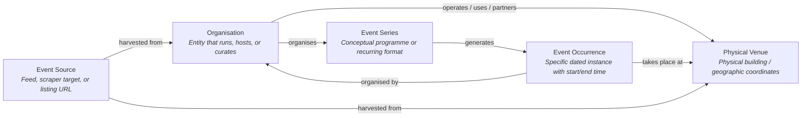

# Architecture Design: Organisation, Venue, Event Series & Occurrence Data Model

**Status: Proposed Architecture Blueprint (Under Review)**  
**Target Repository:** `JsonLord/berlin-cci-atlas`  
**Base Commit:** `31ed7e3611e63f9146a113a17b80dd3b6ec6dbdc` (`main`)  
**Working Branch:** `architecture/organisation-venue-event-model`  
**Scope:** Architecture and data model design only. No production code, data, frontend, CI, or deployment configuration is modified.

---

## 1. Executive Summary

The Berlin Kiez Events Atlas is evolving from a static venue directory (inherited from the Berlin CCI Atlas) into a live, neighbourhood-anchored cultural and community events atlas. 

In Phase 1, the atlas established an auditable 303-venue classification model with official Berlin LOR (Lebensweltlich orientierte Räume) geography (143 Bezirksregionen, 542 Planungsräume), partitioning the inherited directory into 251 included public venues, 43 review-queue items, and 9 exclusions.

In Phase 2, two empirical investigations proved that the current data model cannot publish events without systemic misattribution:
1. **The Berlin.de RSS Pilot (`docs/phase2/pilot/BERLIN_DE_RSS_PILOT.md`):** Testing the assumption of broad calendar coverage refuted the claimed ~110-venue reach. Only 15% (13/86) of library/community venue pages expose a venue-scoped `v_ort` feed, and those feeds exhibit only ~47% venue precision (half the records take place elsewhere).
2. **The Divan Attribution Audit (`docs/phase2/divan/DIVAN_ATTRIBUTION_AUDIT.md`):** Testing source `p2-006` (Interkulturelles Stadtteilzentrum Divan) proved that the claimed 225-event yield did not reproduce (the true count is 221 records across 58 distinct titles). Crucially, Divan operates **two physical buildings** (Nehringstr. 8 and Nehringstr. 26). While 95.5% of events are Divan-organised, only 79.2% (175/221) take place at the mapped building. A model that conflates an organisation with a venue marker inevitably publishes sibling-building events (16.3%) and ambiguous multi-venue events (4.1%) at the wrong physical pin.

### The Architectural Thesis
**An organisation is not a place, a place is not a programme, and a programme is not a date.**

This architecture formally decouples the four fundamental concerns:

---

## 2. Document Map

This architectural blueprint consists of four core documents, designed to be read in order:

| Document | Primary Focus | Key Deliverables |
|---|---|---|
| **[`ORGANISATION_VENUE_MODEL.md`](./ORGANISATION_VENUE_MODEL.md)** | Decoupling legal/community entities from physical buildings | Entity schemas (`Organisation`, `Venue`, `OrganisationVenueRole`), relationship cardinality, evidence hierarchy, multi-venue organisations, co-located venues, virtual events. |
| **[`EVENT_SERIES_OCCURRENCE_MODEL.md`](./EVENT_SERIES_OCCURRENCE_MODEL.md)** | Distinguishing ongoing programmes from dated instances | Entity schemas (`EventSeries`, `EventOccurrence`), recurrence modeling, title/venue overrides, cancellations, cross-source deduplication, stable identity hashing. |
| **[`DATA_MODEL_MIGRATION.md`](./DATA_MODEL_MIGRATION.md)** | Backward-compatible transition from inherited PLACES | Current-to-proposed field mapping, evaluation of 3 migration strategies, projection engine preserving `data/public/venues.json` (v0.3.0) and `index.html` byte integrity, phased roadmap. |
| **[`ARCHITECTURE_DECISIONS.md`](./ARCHITECTURE_DECISIONS.md)** | Rigorous ADR records and unresolved questions | 8 Architectural Decision Records (ADRs) with rationale and trade-offs, 6 exhaustive edge cases, legal/operational blockers requiring owner approval. |

---

## 3. Core Architectural Principles & Boundaries

1. **Lightweight File-Based Architecture:**
   The project remains a file-based Python pipeline producing static JSON/GeoJSON artefacts. No relational database daemon (Postgres), cache (Redis), message broker (RabbitMQ/Kafka), or vector database is introduced. Data volume (~300–500 venues, ~2,000–5,000 active occurrences) is effortlessly handled by structured JSON / JSON Lines on local disk.
2. **Deterministic Rules Over Speculative Automation:**
   Identity resolution, address matching, and attribution rely on explicit, deterministic rules. No large language model (LLM) is used as a mandatory runtime dependency for entity resolution. Ambiguous matches enter a human review queue (`review_queue.json`) rather than silently corrupting public markers.
3. **Preservation of the Working Frontend:**
   The frontend (`index.html`) is byte-checked by `kiez_atlas.cli validate` against committed git blob `927d63a91919`. The new relational data model lives in canonical internal staging (`data/internal/`), while deterministic compiler/projection scripts generate the legacy contracts required by `data/public/` and `index.html`.
4. **Historical Evidence Immutability:**
   Existing Phase 1 inventory (`data/internal/venue_inventory.json`), Phase 2 source registry (`docs/phase2/PHASE2_SOURCE_REGISTRY.json`), and Divan audit artefacts (`DIVAN_ATTRIBUTION_RESULTS.json`, `DIVAN_ATTRIBUTION_SUMMARY.json`, and `divan_kalender_snapshot.html.gz`) are immutable historical records and are not retroactively rewritten.
